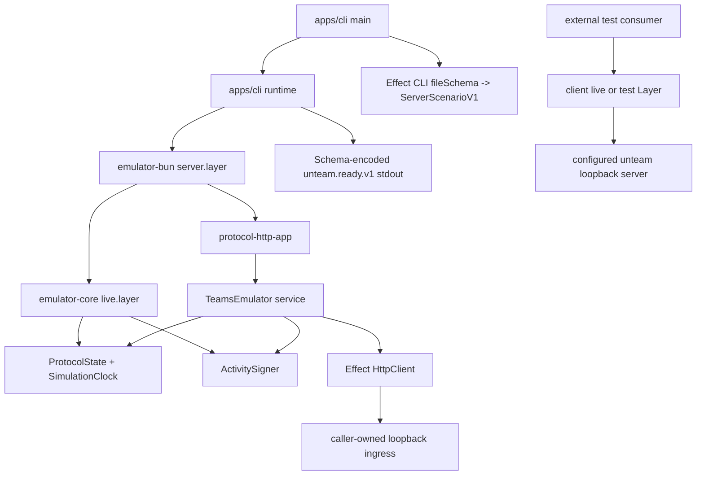

# Ownership map

`unteam` has four small owners. Libraries own no process runtime; the CLI is the only application runtime.

| Owner                   | Owns                                                                                                                                                                                                                          | Must not own                                                                                                                  |
| ----------------------- | ----------------------------------------------------------------------------------------------------------------------------------------------------------------------------------------------------------------------------- | ----------------------------------------------------------------------------------------------------------------------------- |
| `@unteam/emulator-core` | Versioned schemas, exact ingress decoding, typed errors, state, activity signing, protocol HTTP application, public `TeamsEmulator` service, test substitution, protocol counters and bounded synthetic Connector transcripts | A listener, filesystem/config, process signals, Pollsor domain state, raw public HTTP clients, raw tokens or keys             |
| `@unteam/emulator-bun`  | Scoped Effect Platform Bun listener, stable loopback origin, connector-path resolution after port acquisition, Fetch client composition, server host composition                                                              | CLI configuration, process signals, arbitrary hostnames, raw `Bun.listen`/`Bun.connect`, a public generic plugin system       |
| `@unteam/client`        | Versioned, typed HTTP controls for a separately running local emulator; readiness, OpenID/JWK and snapshot checks; one named Effect service with live and test Layers                                                         | Listener ownership, emulator state, Pollsor identities or workflows, process signals, raw credentials in errors               |
| `unteam`                | Required JSON `ServerScenarioV1` file ingress, CLI help/arguments, `unteam.ready.v1`, bounded diagnostics, `BunRuntime.runMain`, and one scoped application runtime                                                           | Protocol state, product workflows, manual signal listeners, nested runtimes, a second listener, package-specific domain logic |

## Call graph

The core public service exposes `origin`, delivery/control Effects, snapshots, bounded observations, protocol counters, and a bounded synthetic Connector transcript. It does not expose the internal state service, signer, HTTP client/server, token records or CryptoKeys. The separate client service exposes only typed operations for a running local server.

## Repository variation

The inspected generic renderer is Site/TanStack-shaped. It was not used because it would add unrelated web, RPC, domain, and deployment owners. The variation retains the repository contract, version snapshot, source conditions, validation, receipts, governance, and local-skill provenance while keeping this CLI/library topology minimal.
