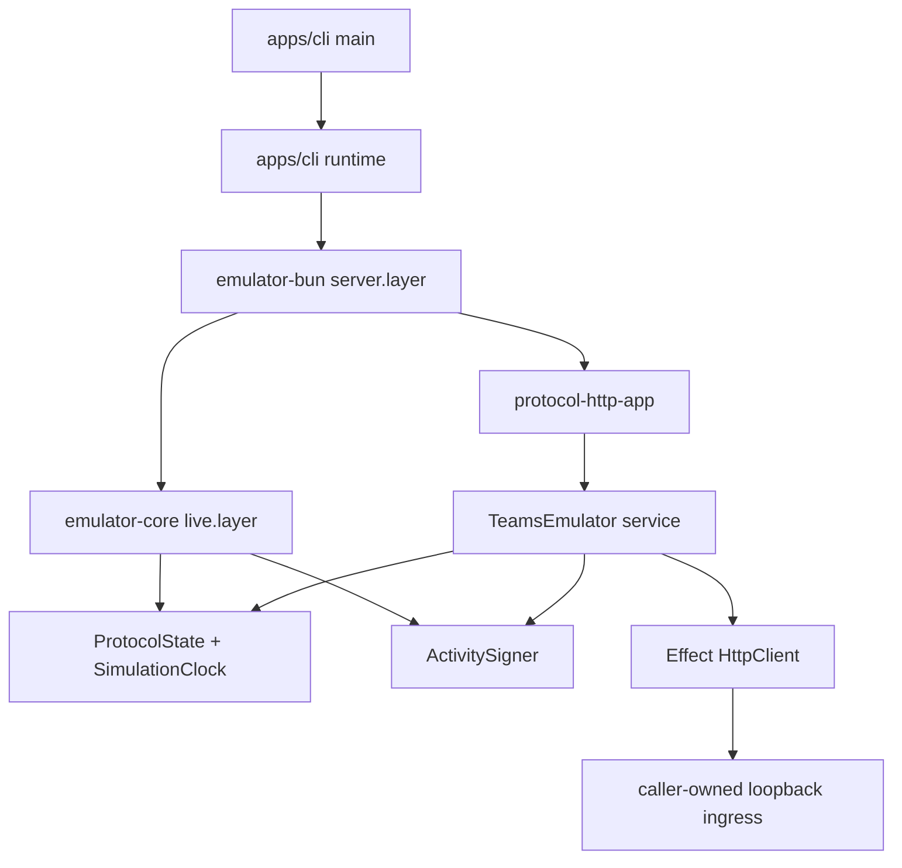

# Ownership map

`unteam` is intentionally a three-owner topology. Libraries own no process runtime; the CLI is the only application runtime.

| Owner                   | Owns                                                                                                                                                           | Must not own                                                                                                            |
| ----------------------- | -------------------------------------------------------------------------------------------------------------------------------------------------------------- | ----------------------------------------------------------------------------------------------------------------------- |
| `@unteam/emulator-core` | Versioned schemas, exact ingress decoding, typed errors, state, activity signing, protocol HTTP application, public `TeamsEmulator` service, test substitution | A listener, filesystem/config, process signals, Pollsor domain state, raw public HTTP clients, raw tokens or keys       |
| `@unteam/emulator-bun`  | Scoped Effect Platform Bun listener, stable loopback origin, Fetch client composition, server host composition                                                 | CLI configuration, process signals, arbitrary hostnames, raw `Bun.listen`/`Bun.connect`, a public generic plugin system |
| `unteam`                | Config/ConfigProvider, config file boundary, CLI arguments, structured startup logging, signal handling, one scoped application runtime                        | Protocol state, product workflows, a second listener, package-specific domain logic                                     |

## Call graph

The public service exposes `origin`, delivery/control Effects, snapshots, and bounded observations. It does not expose the internal state service, signer, HTTP client/server, token records, CryptoKeys, or consumer Layers.

## Repository variation

The inspected generic renderer is Site/TanStack-shaped. It was not used because it would add unrelated web, RPC, domain, and deployment owners. The variation retains the repository contract, version snapshot, source conditions, validation, receipts, governance, and local-skill provenance while keeping this CLI/library topology minimal.
